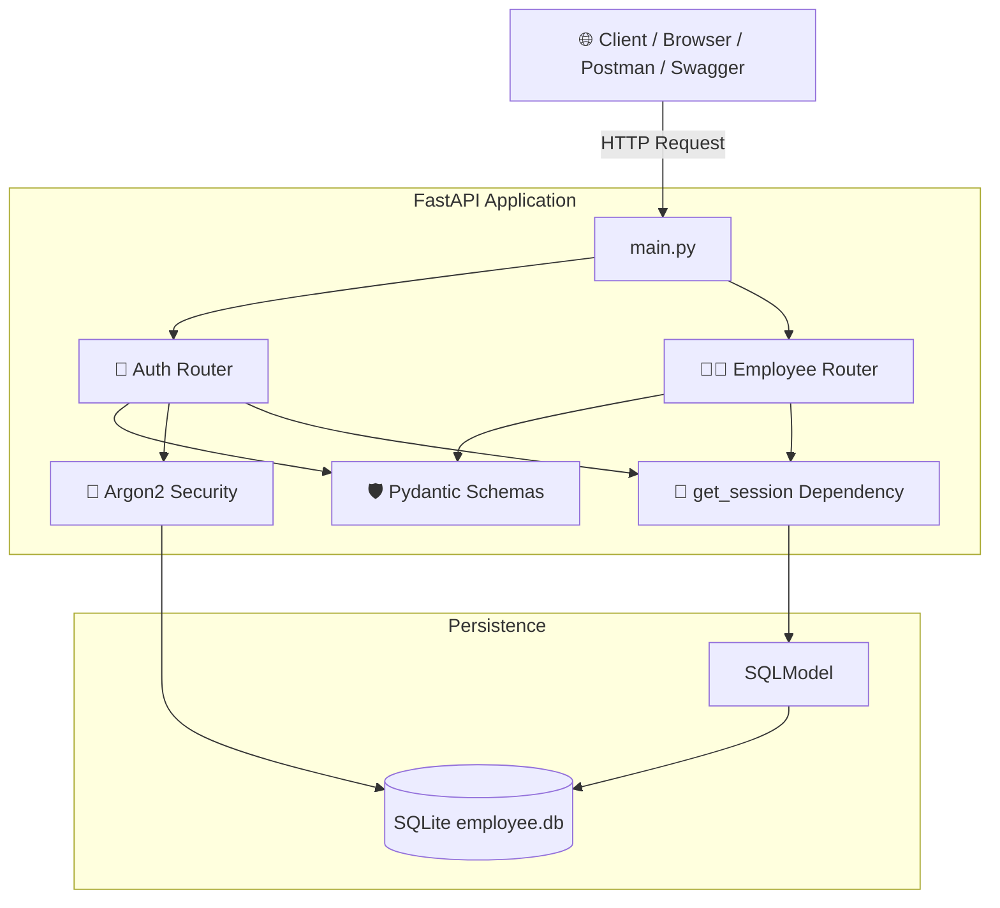
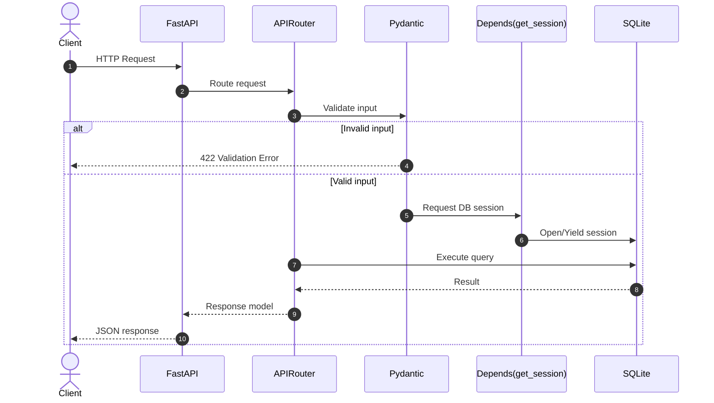
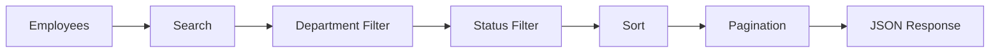
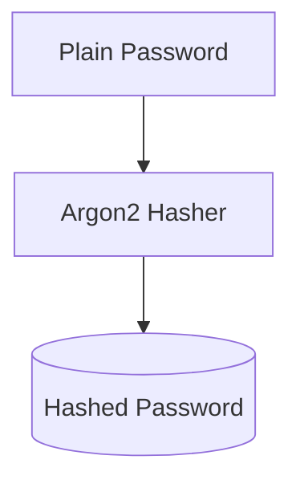
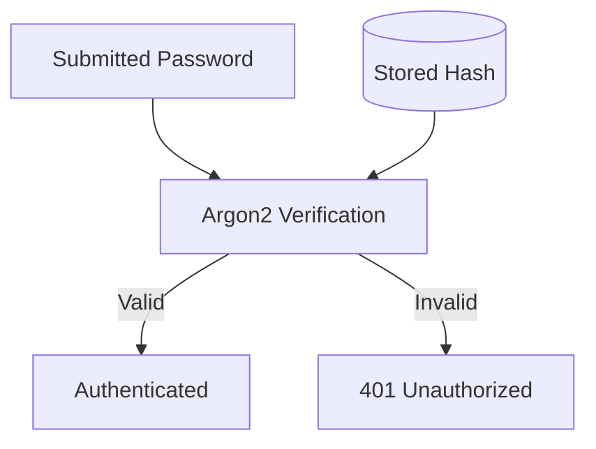
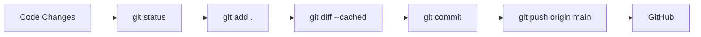

# 👨‍💼 Employee Management REST API

> A production-style Employee Management REST API built with **FastAPI**, **SQLModel**, **Pydantic**, dependency injection, CRUD operations, search, filtering, sorting, pagination, Argon2 password hashing, logging, OpenAPI/Swagger, and Docker.

[](https://www.python.org/)
[](https://fastapi.tiangolo.com/)
[](https://sqlmodel.tiangolo.com/)
[](https://www.sqlite.org/)
[](https://www.docker.com/)
[](https://swagger.io/)

---

## 📌 Table of Contents

<details open>
<summary><b>Click to expand</b></summary>

- [📖 Project Overview](#-project-overview)
- [✨ Features](#-features)
- [🏗️ System Architecture](#️-system-architecture)
- [🔄 Request Lifecycle](#-request-lifecycle)
- [📂 Project Structure](#-project-structure)
- [🛠️ Tech Stack](#️-tech-stack)
- [🚀 Setup & Installation](#-setup--installation)
- [📚 Interactive API Documentation](#-interactive-api-documentation)
- [📡 API Endpoints](#-api-endpoints)
  - [Employee CRUD](#-employee-crud)
  - [Search, Filtering, Sorting & Pagination](#-search-filtering-sorting--pagination)
  - [Authentication](#-authentication)
- [🛡️ Validation & Error Handling](#️-validation--error-handling)
- [💉 Dependency Injection](#-dependency-injection)
- [🔐 Password Security](#-password-security)
- [🐳 Docker](#-docker)
- [🧪 Testing Checklist](#-testing-checklist)
- [🎥 Project Walkthrough](#-project-walkthrough)
- [🌿 Git & GitHub Workflow](#-git--github-workflow)
- [📌 Learning Outcomes](#-learning-outcomes)
- [👨‍💻 Author](#-author)

</details>

---

## 📖 Project Overview

This project implements a **production-style Employee Management REST API** using FastAPI and SQLModel.

The API demonstrates common backend engineering patterns including:

- RESTful CRUD operations
- Request and response validation with Pydantic
- SQLModel-based database access
- FastAPI dependency injection
- Search, filtering, sorting, and pagination
- Authentication with Argon2 password hashing
- Centralized exception handling
- Application logging
- Automatic OpenAPI/Swagger documentation
- Docker containerization

The project is structured into separate modules for routes, schemas, models, database access, and security so that each responsibility remains easy to understand and maintain.

---

## ✨ Features

### 👨‍💼 Employee Management
- Create employee
- Get all employees
- Get employee by ID
- Update employee with `PUT`
- Partially update employee with `PATCH`
- Delete employee

### 🔎 Querying
- Search by employee name or email
- Filter by department
- Filter by active/inactive status
- Sort by name or salary
- Ascending/descending order
- Offset/limit pagination
- Combine multiple query parameters

### 🛡️ API Quality
- Pydantic request validation
- Response models
- HTTP status codes
- 404 handling for missing employees
- 409 handling for duplicate users
- 401 handling for invalid login
- Database exception handling
- Logging

### 🔐 Authentication
- User registration
- Password hashing using Argon2
- Password verification during login

### 🐳 Deployment
- Dockerfile included
- Docker image build
- Containerized Uvicorn server

---

## 🏗️ System Architecture



### Architecture Flow

```text
Client
  ↓
FastAPI Application
  ↓
APIRouter
  ↓
Pydantic Validation
  ↓
Dependency Injection
  ↓
SQLModel
  ↓
SQLite
  ↓
JSON Response
```

---

## 🔄 Request Lifecycle



---

## 📂 Project Structure

```text
employee-mgt-REST_API/
│
├── app/
│   ├── __init__.py
│   ├── main.py
│   ├── database.py
│   │
│   ├── models/
│   │   ├── __init__.py
│   │   ├── employee_model.py
│   │   └── user_model.py
│   │
│   ├── schemas/
│   │   ├── auth.py
│   │   └── employee_schema.py
│   │
│   ├── routers/
│   │   ├── __init__.py
│   │   ├── employees.py
│   │   └── auth.py
│   │
│   └── security/
│       ├── __init__.py
│       └── security.py
│
├── Dockerfile
├── requirements.txt
├── .env.example
├── .gitignore
├── README.md
└── employee.db              # Runtime-generated; should be gitignored
```

### Responsibility of Each Layer

| Layer | Responsibility |
|---|---|
| `main.py` | Creates FastAPI application and mounts routers |
| `database.py` | Database engine and session dependency |
| `models/` | SQLModel database entities |
| `schemas/` | Request and response validation |
| `routers/` | API endpoints and route logic |
| `security/` | Password hashing and verification |
| `Dockerfile` | Container image configuration |

---

## 🛠️ Tech Stack

| Component | Technology | Purpose |
|---|---|---|
| Language | Python 3.13+ | Application development |
| Framework | FastAPI | REST API framework |
| ORM / Models | SQLModel | Database models and queries |
| Validation | Pydantic v2 | Request/response validation |
| Database | SQLite | Local persistence |
| Password Hashing | `pwdlib[argon2]` | Secure password hashing |
| Server | Uvicorn | ASGI application server |
| Containerization | Docker | Reproducible deployment |
| Version Control | Git + GitHub | Source control and project hosting |
| API Documentation | OpenAPI / Swagger / ReDoc | Interactive API documentation |

---

## 🚀 Setup & Installation

### 1. Clone the Repository

```bash
git clone <YOUR_GITHUB_REPOSITORY_URL>
cd employee-mgt-REST_API
```

### 2. Create Virtual Environment

#### macOS / Linux

```bash
python3.13 -m venv venv
source venv/bin/activate
```

#### Windows

```bash
python -m venv venv
venv\Scripts\activate
```

### 3. Install Dependencies

```bash
pip install --upgrade pip
pip install -r requirements.txt
```

> **Important:** `pwdlib[argon2]` is required because the project uses Argon2 password hashing.

### 4. Configure Environment

```bash
cp .env.example .env
```

Example:

```env
DATABASE_URL=sqlite:///employee.db
```

### 5. Start the API

```bash
uvicorn app.main:app --reload --host 127.0.0.1 --port 8000
```

API:

```text
http://127.0.0.1:8000
```

---

## 📚 Interactive API Documentation

FastAPI automatically generates OpenAPI documentation.

| Documentation | URL |
|---|---|
| Swagger UI | `http://127.0.0.1:8000/docs` |
| ReDoc | `http://127.0.0.1:8000/redoc` |
| OpenAPI JSON | `http://127.0.0.1:8000/openapi.json` |

Swagger can be used to send requests directly to the running API.

---

# 📡 API Endpoints

## 👨‍💼 Employee CRUD

Base path:

```text
/employee/employees
```

| Method | Endpoint | Purpose |
|---|---|---|
| `GET` | `/employee/employees/check` | Health/status check |
| `POST` | `/employee/employees/` | Create employee |
| `GET` | `/employee/employees/` | List employees |
| `GET` | `/employee/employees/{id}` | Get employee |
| `PUT` | `/employee/employees/{id}` | Full update |
| `PATCH` | `/employee/employees/{id}` | Partial update |
| `DELETE` | `/employee/employees/{id}` | Delete employee |

### Create Employee

```http
POST /employee/employees/
```

```json
{
  "name": "Vijay Sharma",
  "email": "vijay.sharma@example.com",
  "department": "Engineering",
  "salary": 85000,
  "is_active": true
}
```

### Partial Update

```http
PATCH /employee/employees/1
```

```json
{
  "salary": 92000
}
```

---

## 🔍 Search, Filtering, Sorting & Pagination

The list endpoint supports multiple query parameters.

```text
GET /employee/employees/
```

### Search

```http
GET /employee/employees/?search=Vijay
```

Search can match employee name or email.

### Department Filter

```http
GET /employee/employees/?department=IT
```

### Active Status Filter

```http
GET /employee/employees/?is_active=true
```

### Sort by Salary

```http
GET /employee/employees/?sort_by=salary&order=desc
```

### Pagination

```http
GET /employee/employees/?offset=0&limit=10
```

```http
GET /employee/employees/?offset=10&limit=10
```

The configured limit is capped at a maximum of 50 records per request.

### Combined Query

```http
GET /employee/employees/?department=IT&is_active=true&sort_by=salary&order=desc&limit=5&offset=0
```

### Query Flow



---

## 🔐 Authentication

The authentication subsystem provides user registration and login.

> **Current implementation note:** The existing code currently exposes the authentication routes with the `/auth/...` path because the `/auth` prefix is applied at both router and application inclusion levels. The README documents the current behavior rather than hiding it.

| Method | Current Route | Purpose |
|---|---|---|
| `POST` | `/auth/register` | Register user |
| `POST` | `/auth/login` | Authenticate user |

### Registration

```json
{
  "username": "vijay",
  "password": "StrongPassword@123"
}
```

### Authentication Concepts

```text
Authentication
    ↓
"Who are you?"
    ↓
Username + Password
    ↓
Password Verification
```

This project demonstrates authentication. It does **not** currently implement a complete role-based authorization system such as admin/user permissions.

---

## 🛡️ Validation & Error Handling

Pydantic validates incoming request data before it reaches the database layer.

### Validation

Invalid input can result in:

```text
422 Unprocessable Entity
```

For example, an invalid email format is rejected by the request schema.

### Employee Not Found

A missing employee returns:

```text
404 Not Found
```

Example:

```json
{
  "detail": "999 not found in the records"
}
```

### Duplicate User

Attempting to register an existing username returns:

```text
409 Conflict
```

### Invalid Login

Incorrect credentials return:

```text
401 Unauthorized
```

### Database Errors

Database-related exceptions are handled by the application and logged rather than exposing internal implementation details directly to the client.

---

## 💉 Dependency Injection

The project uses FastAPI dependency injection to provide database sessions to route handlers.

Example:

```python
@router.get("/", response_model=list[EmployeeRead])
def get_employees(
    session: Session = Depends(get_session),
    search: str | None = None
):
    ...
```

### Why Dependency Injection?

- Keeps database session creation outside route logic
- Provides a clean session lifecycle
- Reduces duplicated database setup code
- Makes route logic easier to test and maintain

---

## 🔐 Password Security

Passwords are not stored as plaintext.

The project uses:

```text
pwdlib[argon2]
```

### Registration Flow



### Login Flow



The purpose is to store a password hash rather than the original password.

---

## 🐳 Docker

The API can be packaged and run as a Docker container.

### Build Image

```bash
docker build -t employee-management-api .
```

### Run Container

```bash
docker run --name employee-api -p 8000:8080 employee-management-api
```

This maps:

```text
Host:      8000
    ↓
Docker:    8080
```

The API is then accessible at:

```text
http://127.0.0.1:8000
```

### Check Container

```bash
docker ps
```

### View Logs

```bash
docker logs employee-api
```

### Stop Container

```bash
docker stop employee-api
```

### Remove Container

```bash
docker rm employee-api
```

---

## 🧪 Testing Checklist

The following areas were tested during project development.

### CRUD

- [x] Create employee
- [x] Get employee list
- [x] Get employee by ID
- [x] Update employee with `PUT`
- [x] Partial update with `PATCH`
- [x] Delete employee
- [x] 404 for non-existent employee

### Search / Filter / Sort / Pagination

- [x] Search by name
- [x] Search by email
- [x] Filter by department
- [x] Filter by active status
- [x] Sort by salary
- [x] Pagination with offset/limit
- [x] Combined query parameters

### Authentication

- [x] Register user
- [x] Reject duplicate username
- [x] Login with valid password
- [x] Reject incorrect password
- [x] Password stored as Argon2 hash

### Docker

- [x] Docker image builds
- [x] Container starts successfully
- [x] Uvicorn runs inside container
- [x] Swagger is accessible through mapped host port

### Documentation

- [x] Swagger UI
- [x] ReDoc
- [x] OpenAPI schema

---

## 🎥 Project Walkthrough

For the project video, demonstrate the project in this order:

### 1. Introduction

Explain:

- What problem the API solves
- Why FastAPI was selected
- Project folder structure

### 2. Architecture

Show:

```text
Client
  ↓
FastAPI
  ↓
APIRouter
  ↓
Pydantic
  ↓
Dependency Injection
  ↓
SQLModel
  ↓
SQLite
```

### 3. Swagger Demo

Open:

```text
http://127.0.0.1:8000/docs
```

Demonstrate:

1. Create employee
2. Get employees
3. Get employee by ID
4. Update employee
5. Patch employee
6. Delete employee
7. Search
8. Filter
9. Sort
10. Pagination

### 4. Authentication

Demonstrate:

1. Register user
2. Attempt duplicate registration
3. Login with wrong password
4. Login with correct password
5. Explain Argon2 hashing

### 5. Docker

Show:

```bash
docker build -t employee-management-api .
docker run --name employee-api -p 8000:8080 employee-management-api
```

Then open Swagger through port `8000`.

---

## 🌿 Git & GitHub Workflow

Recommended workflow:



### Check Changes

```bash
git status
```

### Stage Changes

```bash
git add .
```

### Review Staged Changes

```bash
git diff --cached
```

### Commit

```bash
git commit -m "Complete employee management REST API"
```

### Push

```bash
git push origin main
```

### Important Files to Keep Out of Git

Your `.gitignore` should exclude:

```text
venv/
.venv/
.env
__pycache__/
*.pyc
*.db
```

Never commit real passwords, API keys, or other secrets.

---

## 📌 Learning Outcomes

This project demonstrates practical understanding of:

- REST API design
- FastAPI routing
- `APIRouter`
- Pydantic validation
- Response models
- SQLModel
- SQLite
- Dependency injection
- CRUD operations
- Search and filtering
- Sorting
- Pagination
- Exception handling
- Logging
- Password hashing with Argon2
- Swagger / OpenAPI
- Docker containerization
- Git and GitHub workflow

---

## 👨‍💻 Author

**Vijay Rangvani**

*Backend & AI Engineering Learner*

---

> Built with **FastAPI, SQLModel, Python 3.13, SQLite, and Docker**.
